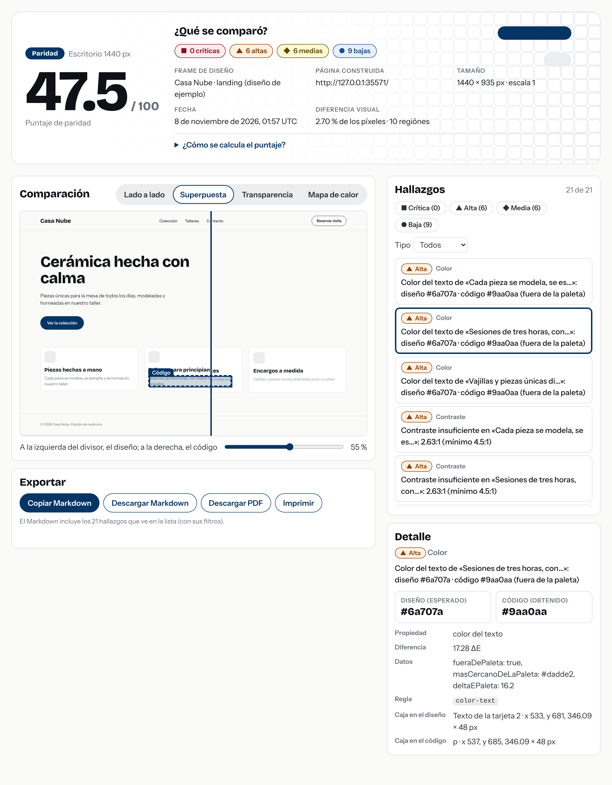
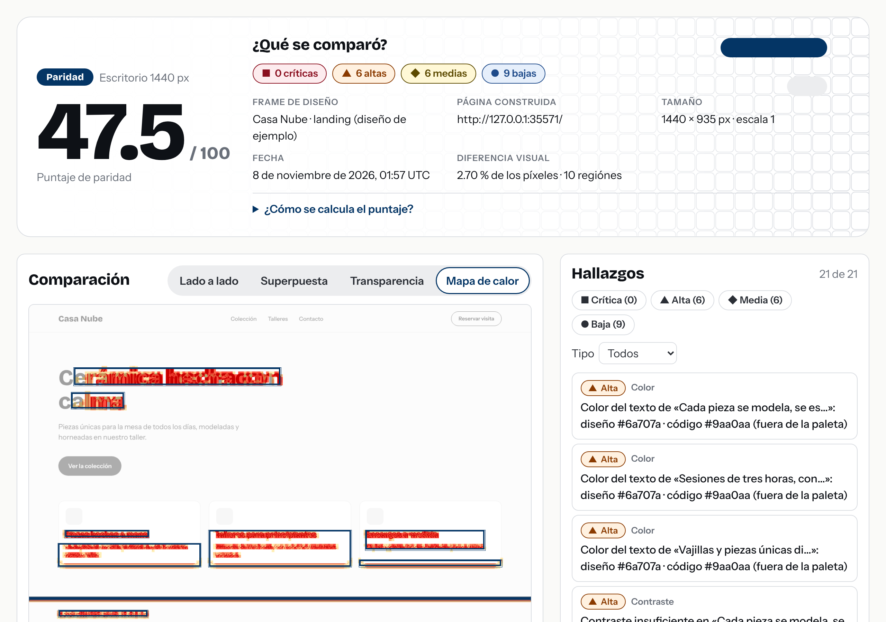
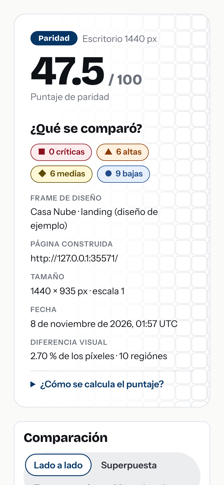

# Paridad

**Interfaces pensadas para implementarse, convertidas en herramienta.** Paridad compara un **frame de Figma** con la **página ya construida** y reporta lo que no coincide: espaciados, colores fuera de la paleta, tipografías, textos cortados, elementos que faltan o sobran y problemas de contraste. Cada diferencia trae **evidencia medible** (el valor del diseño frente al del código, y las cajas en ambas imágenes) y una **severidad**.

Es un proyecto personal de Nehemias Pérez (Diseñador UI/UX) para su sección «Laboratorio». Se hizo para aprender a trabajar con Claude Code, no solo para que funcione: las decisiones técnicas están explicadas, una por una, en [`CLAUDE.md`](CLAUDE.md).



## Cómo funciona

```
Figma (API REST) ──► snapshot de diseño ─┐
                                         ├─► emparejar ─► reglas ─► severidad ─► puntaje ─► report.json ─► app web / Markdown / PDF
página (Playwright) ─► snapshot de página ┘        │
        └── imágenes ─► diferencia de píxeles ─► regiones ──┘   (opcional: capa de IA que agrupa y redacta)
```

Todo se convierte al mismo formato, el **snapshot** ([`docs/snapshot.md`](docs/snapshot.md)): tamaño del lienzo, imagen y una lista de elementos con posición, tamaño y estilos. El motor solo compara snapshots, así que se prueba sin red ni Figma.

## Instalación

Requisitos: Node 22 o superior.

```bash
npm install
npx playwright install chromium   # solo si su máquina no lo tiene
cp .env.example .env.local        # y complete FIGMA_TOKEN
```

El token de Figma es personal y de solo lectura (Settings → Security → Personal access tokens, con permiso de lectura de archivos). Vive en `.env.local`, que **nunca se sube** al repositorio.

## Uso

```bash
# Todo en uno: lee el frame, captura la página (a su mismo ancho), compara y abre el reporte
npm run paridad -- compare --figma "https://www.figma.com/design/CLAVE/Nombre?node-id=1-2" --page http://localhost:3000 --open

# Por pasos
npm run paridad -- figma   --url "<enlace del frame>" --out out/design
npm run paridad -- capture --page http://localhost:3000 --width 1440 --out out/page
npm run paridad -- compare --design out/design/snapshot.json --page out/page/snapshot.json --out out/compare

# Ver y resumir un reporte
npm run paridad -- report  --dir out/compare                       # varias --dir = una pestaña por tamaño
npm run paridad -- summary --dir out/compare                       # críticos y altos, o --json
```

Solo se captura **lo que usted indica** (localhost o URL que pasa a mano); Paridad nunca rastrea sitios.

### Configuración

`paridad.config.ts` (en la raíz) define las tolerancias —lo que está por debajo es ruido y no se reporta— y qué reglas se apagan:

```ts
import { defineConfig } from "@paridad/core";

export default defineConfig({
  tolerances: { position: 1, spacing: 1, size: 1, colorDeltaE: 2 },
  // disabledRules: ["opacity"],
});
```

El criterio de **severidad** y el **puntaje de paridad** (de 0 a 100, con el desglose de cuánto resta cada categoría) están en [`CLAUDE.md`](CLAUDE.md#severidad-y-puntaje-criterio-propuesto--para-su-revisión).

**Contenido dinámico** (fechas, avatares, carruseles): use `--ignore-selector ".fecha"` o `--ignore-rect 0,0,200,80`; se ignora en ambos lados.

## El reporte

La app web (`apps/report`, Next.js) muestra el puntaje, el conteo por severidad y qué se comparó; cuatro vistas (**lado a lado**, **superpuesta** con divisor, **transparencia** ajustable y **mapa de calor**); y la lista de hallazgos filtrable por severidad y tipo, donde al hacer clic se resalta el elemento en ambas imágenes y se ve lo esperado contra lo obtenido. Exporta **Markdown** (listo para un issue de GitHub) y **PDF**. Es accesible: se usa con teclado, cumple contraste y la severidad no depende solo del color (auditado con axe-core).

| Mapa de calor | Móvil |
|---|---|
|  |  |

Un [video corto del flujo](docs/media/flujo-del-reporte.webm) y las capturas se regeneran con `npm run media`.

## Dentro de Claude Code

- **`/paridad <enlace del frame> <URL de la página>`**: una *skill* que corre la comparación y resume los hallazgos críticos y altos, citando solo cifras que salen de la medición ([`.claude/skills/paridad/SKILL.md`](.claude/skills/paridad/SKILL.md)). Solo la invoca usted.
- **Hook** que corre las pruebas del paquete que se acaba de editar ([`scripts/test-edited-package.mjs`](scripts/test-edited-package.mjs)).
- **Subagente `mutation-proposer`** que propone errores nuevos para las evaluaciones ([`.claude/agents/`](.claude/agents/mutation-proposer.md)).

## En cada pull request (opcional)

Una acción compuesta compara una lista de pantallas y deja el puntaje como comentario (se actualiza, no se duplica). Vea [`docs/github-action.md`](docs/github-action.md): **no está probada en GitHub real**, solo sus piezas (`npm run paridad -- ci` y la estructura de los archivos).

## ¿Acierta? Evaluaciones

```bash
npm run evals
```

Aplica errores conocidos a la página de ejemplo (padding, separación, colores parecidos, pesos, textos cortados, elementos que faltan o sobran, contraste…), mide **detección**, **precisión** y **severidad** por tipo de error, y revisa que la página **sin errores** casi no reporte nada. Resultado actual y lo que se aprendió en el camino: [`CLAUDE.md`](CLAUDE.md#evaluaciones-qué-se-mide-y-cómo). Con las 10 mutaciones que propuso un subagente **sin ver la implementación**: 9 de 10 pasan; el que falla es una limitación conocida y está documentado.

## IA (opcional y apagada por defecto)

`--ai` agrupa hallazgos relacionados, propone descartar ruido evidente y redacta una explicación con sugerencia de CSS, con **Claude Haiku** por defecto. La IA **no inventa hallazgos**: su respuesta se valida contra la evidencia que midió el motor y lo que no se apoya en ella se rechaza. Las imágenes se envían recortadas, las respuestas se guardan en caché local y hay un tope de costo por corrida. **Falta medir si ayuda con un modelo real** (en el entorno de desarrollo no había clave), por eso queda apagada hasta que `npm run evals -- --ai` lo demuestre.

## Limitaciones conocidas

- **Contenido dinámico** (fechas, datos reales, anuncios) genera diferencias falsas: para eso están las zonas a ignorar.
- **Fuentes:** si el sitio no carga la misma fuente que Figma, todo el texto difiere. Paridad lo detecta y lo reporta **una sola vez** como crítico.
- **Diseños responsivos:** cada frame corresponde a **un** tamaño de ventana; no se interpolan tamaños intermedios.
- **El traductor de Figma no se ha validado contra un archivo real**: se probó con datos que tienen la forma documentada de la API (ver D-029 en `CLAUDE.md`). Pruébelo con su archivo y su token.
- No entiende gradientes, imágenes de fondo, bordes distintos por lado, Shadow DOM ni iframes, ni el orden de apilamiento con `z-index` (lista completa en las decisiones D-025, D-027).
- Una región de píxeles que mezcla contenido movido y contenido nuevo queda «sin clasificar».
- Ningún diseño real de clientes ni de empresas está en el repositorio: la página de ejemplo («Casa Nube») y sus datos son ficticios.

## Estructura

```
packages/core      snapshot (Zod), emparejado, reglas, severidad, puntaje, reporte
packages/capture   Playwright: página → snapshot
packages/figma     API REST de Figma: frame → snapshot, con caché
packages/visual    diferencia de píxeles, regiones y mapa de calor
packages/ai        capa opcional con Claude
packages/evals     mutaciones, métricas, comparación entre corridas
apps/cli           paridad capture | figma | compare | summary | ci | report
apps/report        reporte web (Next.js)
fixtures/          página de ejemplo y datos de prueba compartidos
```

## Desarrollo

```bash
npm test             # todas las pruebas (Vitest; las de captura, evals y reporte abren Chromium)
npm run typecheck
npm test -w packages/core   # solo un paquete
```

Fuentes: Bricolage Grotesque e Instrument Sans (SIL OFL, ver `apps/report/src/fonts/`).
