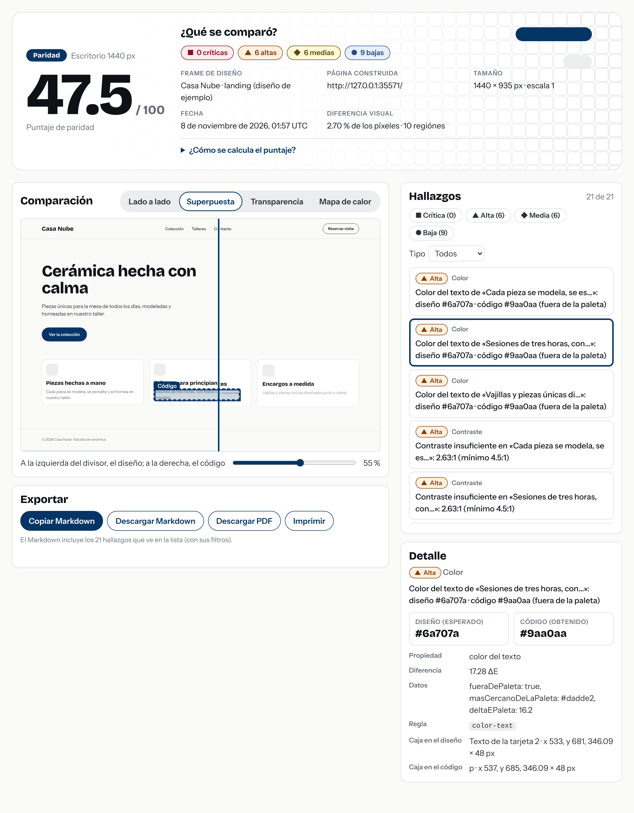

# Caso de estudio · Paridad

> **Borrador para el «Laboratorio» de nehemiasperez.com.** Está escrito en primera persona para que lo ajuste a su voz. Los **[recuadros en corchetes]** son lo único que solo usted puede poner (la anécdota y sus tiempos reales). Todo lo demás —decisiones, cifras, lo que falló— sale de lo que de verdad pasó al construir el proyecto, y cada cifra se puede reproducir con los comandos indicados.
>
> Reglas del material: sin nombres de empresas ni de clientes; los ejemplos usan la página ficticia «Casa Nube».

---

## 1. El problema

**«Interfaces pensadas para implementarse»** es mi frase de marca, y tiene un problema incómodo: ¿cómo sé que lo que diseñé es lo que se construyó?

Hoy esa pregunta se contesta con ojo: se abre Figma en una pantalla, el navegador en otra, y alguien parpadea entre las dos. Funciona hasta que no funciona: el padding que era de 16 y quedó en 20, el azul «parecido» que no es el azul, el texto que se corta con puntos suspensivos en un celular, la fuente que no cargó y todo cayó a otra.

**[Su anécdota aquí. Una situación real de diseño que se perdió al implementarse, sin nombrar empresa ni cliente. Preguntas que ayudan: ¿qué se había diseñado y qué salió? ¿cuánto tardó alguien en notarlo y quién lo notó? ¿qué costó arreglarlo —tiempo, una revisión, una conversación incómoda—? ¿qué le habría gustado tener ese día en la mano? Dos o tres frases bastan; lo concreto convence más que lo grande.]**

Lo que quería era una herramienta que, en vez de «se ve parecido», dijera: *«Padding: diseño 16 px · código 20 px, en estas tres tarjetas»*, con un número, un lugar y una severidad.

## 2. Qué construí

Paridad toma un frame de Figma y la página construida, los compara y reporta lo que no coincide, con evidencia medible. Todo se convierte a un mismo formato (el *snapshot*), así el motor se prueba sin Figma ni red.

- **Captura** con Playwright en condiciones fijas (ancho del frame, sin animaciones, esperando fuentes y red).
- **Lectura de Figma** por la API REST de solo lectura, con caché.
- **Motor**: empareja elementos, aplica reglas (posición y espaciado, tamaño, tipografía, color con ΔE, textos cortados, contraste WCAG), asigna severidad y calcula un puntaje de 0 a 100 que se explica.
- **Diferencia por píxeles** con mapa de calor, cruzada con los hallazgos.
- **Reporte web** (cuatro vistas, filtros, Markdown para un issue, PDF) y una **skill** `/paridad` para usarlo desde Claude Code.
- **Evaluaciones** que miden si la herramienta acierta, y una **capa de IA opcional**.

[Video corto del flujo](media/flujo-del-reporte.webm) · se regenera con `npm run media`.

## 3. Las decisiones que importan

**Qué cuenta como diferencia (y qué es ruido).** La decisión de diseño más importante no fue técnica: fue decidir qué *no* reportar. Cada regla tiene una **tolerancia** (1 px de posición, ΔE 2 de color: lo que el ojo no distingue) y lo que queda por debajo no existe. Sin eso, la herramienta se vuelve una máquina de generar tickets que nadie lee. El criterio de severidad (crítica / alta / media / baja) está escrito y es revisable en [`CLAUDE.md`](../CLAUDE.md); por ejemplo, un elemento que falta es crítico y una diferencia de 1 px es baja.

**Causa raíz, no síntomas.** Si una tarjeta baja 4 px, no quiero 12 hallazgos, uno por cada hijo. La posición se mide **respecto al contenedor**, el espaciado se atribuye al elemento que está fuera de sitio, una caja que falta es **un** hallazgo con la cuenta de lo que había dentro, y una fuente que no cargó es **uno solo**, no uno por texto. Es la diferencia entre un reporte que un desarrollador lee y uno que cierra.

**Por qué la IA solo explica y no detecta.** Un modelo puede resumir y redactar bien, pero si también *detecta*, ya no puedo defender ninguna cifra del reporte. Así que la IA solo ve lo que midió el motor y su respuesta se **valida**: cada grupo debe citar hallazgos que existen y usar únicamente cifras y colores que estén en la evidencia; lo que no, se rechaza. No puede descartar un hallazgo crítico. Y se queda **apagada por defecto** hasta demostrar que mejora algo (ver el punto 4).

**Probar sin Figma.** Todo pasa por el snapshot, así que las pruebas usan datos guardados y corren sin red. Costo: el traductor de Figma se probó con datos con la *forma* documentada de la API, no con un archivo real; eso está dicho con todas sus letras en el proyecto.

## 4. Qué tan bien acierta (las métricas)

Medí con `npm run evals`: aplico errores conocidos a la página de ejemplo (26 mutaciones propias —22 con errores y 4 de ruido—: padding, separación, colores parecidos, pesos, textos cortados, elementos que faltan o sobran, contraste…), capturo la página real con Chromium y comparo. Detección = errores encontrados / errores sembrados; precisión = hallazgos reales / hallazgos reportados; y una **página de control** (la página intacta más cambios invisibles, como 0.2 px) que no debería reportar nada.

| Corrida | Detección | Precisión | Severidad bien asignada | Falsos positivos en control |
|---|---|---|---|---|
| **Primera**, mutaciones propias | 96 % | **58,5 %** | 97,9 % | 0 % |
| Tras corregir lo que reveló, mutaciones propias | 100 % | 100 % | 100 % | 0 % |
| **10 mutaciones de un subagente** que no vio la implementación | 100 % | 98,6 % | 100 % | 0 % |

Dos cosas que me importa contar:

1. **Ese 100 % no prueba nada, y lo sé.** Escribí las mutaciones y ajusté la herramienta mirando sus resultados. Por eso pedí a un **subagente** que propusiera casos nuevos *sin* poder leer el motor ni los resultados, solo la página, el diseño y el criterio de severidad. Esa es la cifra que cuenta: 9 de 10 pasan. El que falla (un enlace nuevo en una navegación centrada) mezcla contenido movido y contenido nuevo en la misma región de píxeles y queda «sin clasificar»: una limitación real, documentada, que no escondí ajustando la herramienta.
2. **La primera corrida fue la más valiosa.** Detectaba casi todo (96 %) pero la precisión era 58,5 %: el 40 % de lo que reportaba era ruido. La causa no eran las expectativas, eran defectos reales: las diferencias de píxeles que eran *consecuencia* de un cambio de layout (el pie baja 8 px) se reportaban como «diferencia sin explicar». La solución fue reconocer una región que es **una copia desplazada** del diseño.

**Con y sin IA.** El comando existe (`npm run evals -- --ai`) y compara las mismas mutaciones con la capa de IA aplicada: precisión (un descarte de un falso positivo la sube; uno de un acierto pierde detección y cuenta como «descarte dañino») y claridad (cuántos elementos tiene que leer una persona). La regla de decisión está en código: la IA se enciende por defecto solo si mejora la precisión ≥ 2 puntos o la claridad ≥ 20 %, sin perder detección ni ocultar errores reales.

> **[Pendiente de completar: la cifra con y sin IA.]** No pude medirlo: el entorno donde construí esto no tenía clave de la API, así que la capa se probó entera con modelos falsos (uno bueno y varios tramposos que inventan ids, cifras o colores) pero **no se ha medido a Claude de verdad**. Cuando corra `npm run evals -- --ai` con su clave (unas 40 llamadas de Haiku, centavos de dólar), la tabla y la decisión salen solas; si no mejora, «apagada por defecto» es un resultado igual de publicable.

## 5. Lo que aprendí

- **Medir antes de creer.** Sin la página de control y las mutaciones habría seguido pensando que funcionaba: «detecta todo» era verdad, «y casi nunca se equivoca» era falso.
- **Una prueba que nunca falla no es una prueba.** Descubrí que `npm test` ignoraba toda la carpeta `apps/` sin avisar (faltaba en una lista) y que las pruebas de ese paquete jamás corrían. Ahora una prueba vigila que todo paquete con pruebas esté incluido. Con la accesibilidad, igual: agregué una prueba de que el auditor sí detecta una violación inyectada, para no confiar en uno que siempre dice «todo bien».
- **Una prueba bien escrita encuentra bugs que uno no buscaba.** Una verificación de que las fuentes de la marca cargaban reveló que una variable CSS mía las estaba pisando y todo caía a la fuente del sistema, sin ningún error. Otra mostró que mi defensa contra cifras inventadas dejaba pasar un «24 px» inventado (aceptaba la diferencia entre *cualquier* par de cifras de la evidencia).
- **Las herramientas automáticas no lo ven todo.** Una captura de pantalla en móvil mostró una píldora decorativa tapando un texto, algo que el auditor de accesibilidad no puede ver.
- **Separar lo que mide de lo que opina.** La parte difícil de la IA no fue llamar al modelo, fue limitarla: validar su salida contra la evidencia y decidir con una regla, escrita de antemano, si merece quedarse encendida.
- **Un subagente es útil sobre todo por lo que *no* sabe.** Su valor fue ser un evaluador ciego.

## 6. Lo que haría distinto

- **Validar con un archivo de Figma real desde el día uno.** Construí el traductor contra la documentación porque no tenía un token a mano; es el mayor riesgo que queda.
- **Medir la IA antes de construir tanto alrededor de ella.** Dejé toda la tubería lista y la decisión sin datos. Con una clave desde el principio habría empezado por la medición.
- **Más tamaños y más páginas.** Todo se midió sobre una landing de cuatro secciones; el siguiente paso honesto es una página real, con contenido dinámico y varios puntos de quiebre.
- **Una región de píxeles debería poder partirse** en «lo que se movió» y «lo que es nuevo»; hoy esa mezcla queda sin clasificar.

---

### Para armar la página del portafolio

- **Titular sugerido:** «Paridad: medir si el código es el diseño».
- **Capturas:** [`media/reporte-hallazgo.png`](media/reporte-hallazgo.png), [`media/reporte-mapa-de-calor.png`](media/reporte-mapa-de-calor.png), [`media/reporte-movil.png`](media/reporte-movil.png), [`media/reporte-resumen.png`](media/reporte-resumen.png).
- **Video:** [`media/flujo-del-reporte.webm`](media/flujo-del-reporte.webm) (≈ 30 s: elegir un hallazgo, divisor, transparencia, mapa de calor, filtro y exportación).
- **Cifras para citar** (todas reproducibles): primera corrida 96 % / 58,5 % / 97,9 %; independiente 100 % / 98,6 % / 100 %; control 0 % de falsos positivos; criterio de severidad y puntaje en `CLAUDE.md`.
