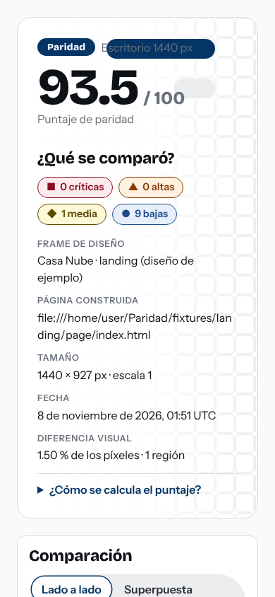

# La píldora decorativa tapaba el texto en móvil

**Qué pasó.** Al construir el reporte web de Paridad, el motivo de la marca (una cuadrícula de cuadros con una píldora azul) quedaba **encima del texto** «Escritorio 1440 px» cuando el encabezado se apilaba en un celular.

**Por qué es una buena historia.** Las 52 pruebas automáticas pasaban, incluida una auditoría de accesibilidad con axe-core (WCAG 2.1 AA), y aun así el defecto estaba ahí: un auditor automático no ve que un adorno decorativo tape un texto. Lo encontró una **captura de pantalla** revisada con los ojos.

**La corrección.** Ocultar las píldoras decorativas cuando el encabezado se apila (`.motif-pill { display: none }` bajo 1000 px).

**Lo que quedó después.** Una prueba de punta a punta que verifica que, en móvil, la píldora no se muestra. Y una regla para el proyecto: *las herramientas automáticas no lo ven todo*; también hay que mirar.

> Es exactamente el tipo de diferencia que Paridad existe para encontrar entre un diseño y su implementación: algo que «funciona» y aun así no se ve como se diseñó.
