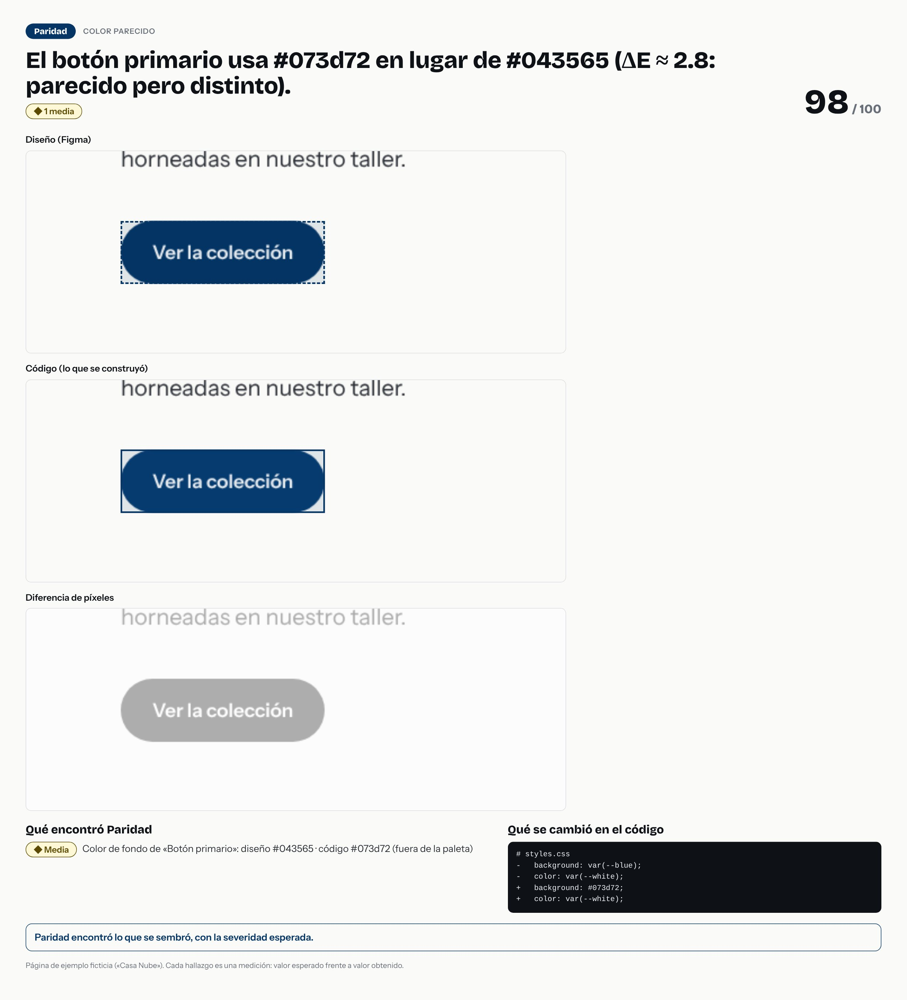

# El botón primario usa #073d72 en lugar de #043565 (ΔE ≈ 2.8: parecido pero distinto).



- **Tipo de error:** color-parecido
- **Puntaje de paridad:** 98 / 100
- **Hallazgos:** 0 críticas · 0 altas · 1 medias · 0 bajas
- **Resultado de la evaluación:** ✅ acertó

## Lo que se cambió en el código

```diff
# styles.css
-   background: var(--blue);
-   color: var(--white);
+   background: #073d72;
+   color: var(--white);
```

## Lo que Paridad encontró

- **Media** · Color de fondo de «Botón primario»: diseño #043565 · código #073d72 (fuera de la paleta)
  - color de fondo: diseño `"#043565"` · código `"#073d72"`

> Pasos para un caso de portafolio: la imagen es la historia visual; el `diff` es la causa; los hallazgos son la evidencia. Sin nombres de empresas ni de clientes.
