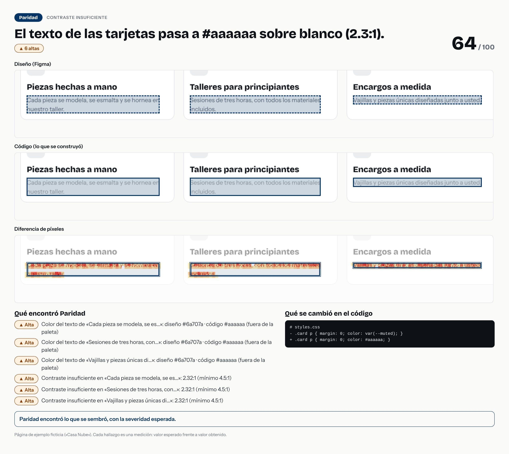

# El texto de las tarjetas pasa a #aaaaaa sobre blanco (2.3:1).



- **Tipo de error:** contraste-insuficiente
- **Puntaje de paridad:** 64 / 100
- **Hallazgos:** 0 críticas · 6 altas · 0 medias · 0 bajas
- **Resultado de la evaluación:** ✅ acertó

## Lo que se cambió en el código

```diff
# styles.css
- .card p { margin: 0; color: var(--muted); }
+ .card p { margin: 0; color: #aaaaaa; }
```

## Lo que Paridad encontró

- **Alta** · Color del texto de «Cada pieza se modela, se es…»: diseño #6a707a · código #aaaaaa (fuera de la paleta)
  - color del texto: diseño `"#6a707a"` · código `"#aaaaaa"`
- **Alta** · Color del texto de «Sesiones de tres horas, con…»: diseño #6a707a · código #aaaaaa (fuera de la paleta)
  - color del texto: diseño `"#6a707a"` · código `"#aaaaaa"`
- **Alta** · Color del texto de «Vajillas y piezas únicas di…»: diseño #6a707a · código #aaaaaa (fuera de la paleta)
  - color del texto: diseño `"#6a707a"` · código `"#aaaaaa"`
- **Alta** · Contraste insuficiente en «Cada pieza se modela, se es…»: 2.32:1 (mínimo 4.5:1)
  - contraste WCAG AA: diseño `"≥ 4.5:1"` · código `"2.32:1"`
- **Alta** · Contraste insuficiente en «Sesiones de tres horas, con…»: 2.32:1 (mínimo 4.5:1)
  - contraste WCAG AA: diseño `"≥ 4.5:1"` · código `"2.32:1"`
- **Alta** · Contraste insuficiente en «Vajillas y piezas únicas di…»: 2.32:1 (mínimo 4.5:1)
  - contraste WCAG AA: diseño `"≥ 4.5:1"` · código `"2.32:1"`

> Pasos para un caso de portafolio: la imagen es la historia visual; el `diff` es la causa; los hallazgos son la evidencia. Sin nombres de empresas ni de clientes.
