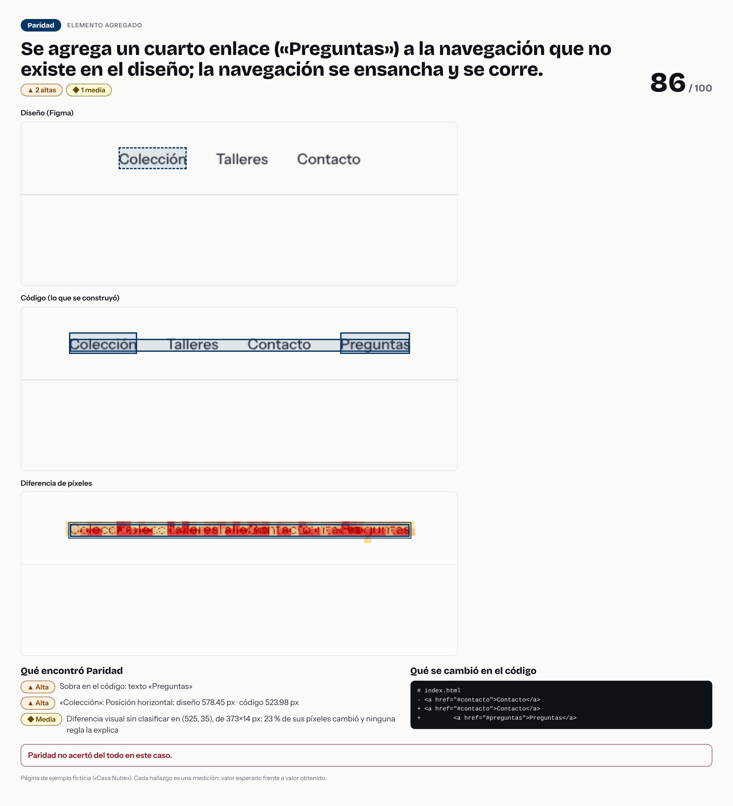

# Se agrega un cuarto enlace («Preguntas») a la navegación que no existe en el diseño; la navegación se ensancha y se corre.



- **Tipo de error:** elemento-agregado
- **Puntaje de paridad:** 86 / 100
- **Hallazgos:** 0 críticas · 2 altas · 1 medias · 0 bajas
- **Resultado de la evaluación:** ❌ no acertó del todo

## Lo que se cambió en el código

```diff
# index.html
- <a href="#contacto">Contacto</a>
+ <a href="#contacto">Contacto</a>
+         <a href="#preguntas">Preguntas</a>
```

## Lo que Paridad encontró

- **Alta** · Sobra en el código: texto «Preguntas»
  - presencia: diseño `"ausente"` · código `"presente"`
- **Alta** · «Colección»: Posición horizontal: diseño 578.45 px · código 523.98 px
  - posición en la página: diseño `{"x":578.45,"y":27.5}` · código `{"x":523.98,"y":27.5}`
- **Media** · Diferencia visual sin clasificar en (525, 35), de 373×14 px: 23 % de sus píxeles cambió y ninguna regla la explica
  - píxeles distintos: diseño `0` · código `1210`

## Dónde falló Paridad

- Falso positivo [medium] visual-unclassified: Diferencia visual sin clasificar en (525, 35), de 373×14 px: 23 % de sus píxeles cambió y ninguna regla la explica

> Pasos para un caso de portafolio: la imagen es la historia visual; el `diff` es la causa; los hallazgos son la evidencia. Sin nombres de empresas ni de clientes.
