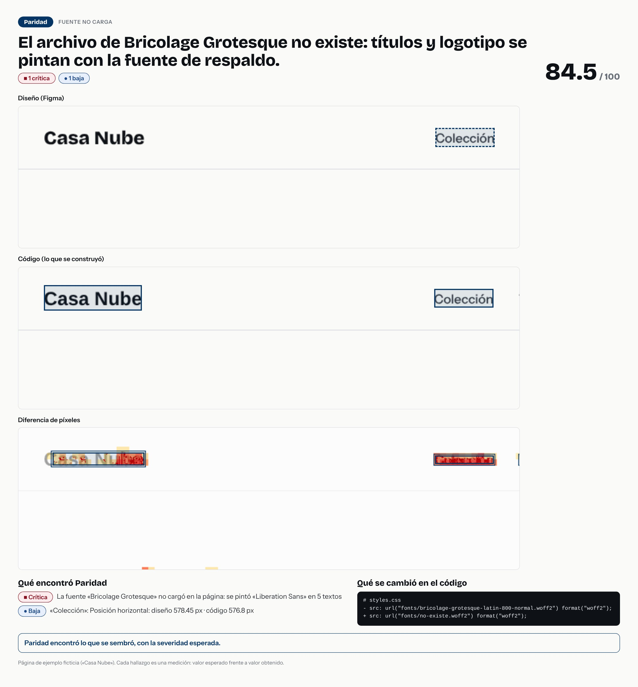

# El archivo de Bricolage Grotesque no existe: títulos y logotipo se pintan con la fuente de respaldo.



- **Tipo de error:** fuente-no-carga
- **Puntaje de paridad:** 84.5 / 100
- **Hallazgos:** 1 críticas · 0 altas · 0 medias · 1 bajas
- **Resultado de la evaluación:** ✅ acertó

## Lo que se cambió en el código

```diff
# styles.css
- src: url("fonts/bricolage-grotesque-latin-800-normal.woff2") format("woff2");
+ src: url("fonts/no-existe.woff2") format("woff2");
```

## Lo que Paridad encontró

- **Crítica** · La fuente «Bricolage Grotesque» no cargó en la página: se pintó «Liberation Sans» en 5 textos
  - fuente cargada: diseño `"Bricolage Grotesque"` · código `"Liberation Sans"`
- **Baja** · «Colección»: Posición horizontal: diseño 578.45 px · código 576.8 px
  - posición en la página: diseño `{"x":578.45,"y":27.5}` · código `{"x":576.8,"y":27.5}`

> Pasos para un caso de portafolio: la imagen es la historia visual; el `diff` es la causa; los hallazgos son la evidencia. Sin nombres de empresas ni de clientes.
