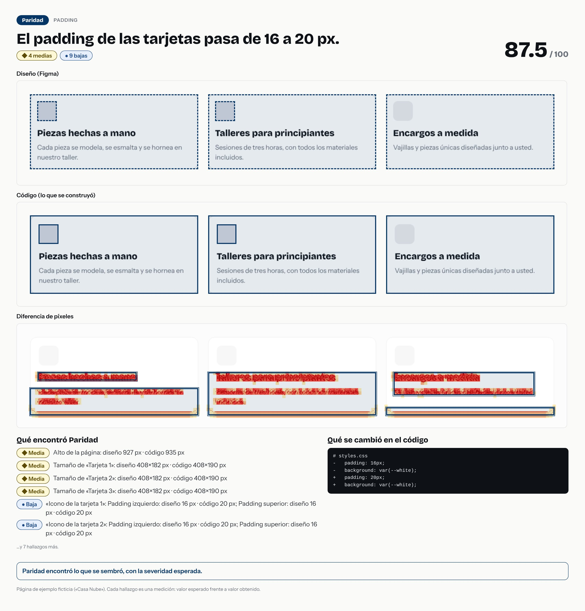

# El padding de las tarjetas pasa de 16 a 20 px.



- **Tipo de error:** padding
- **Puntaje de paridad:** 87.5 / 100
- **Hallazgos:** 0 críticas · 0 altas · 4 medias · 9 bajas
- **Resultado de la evaluación:** ✅ acertó

## Lo que se cambió en el código

```diff
# styles.css
-   padding: 16px;
-   background: var(--white);
+   padding: 20px;
+   background: var(--white);
```

## Lo que Paridad encontró

- **Media** · Alto de la página: diseño 927 px · código 935 px
  - alto de la página: diseño `927` · código `935`
- **Media** · Tamaño de «Tarjeta 1»: diseño 408×182 px · código 408×190 px
  - tamaño: diseño `{"width":408,"height":182}` · código `{"width":408,"height":190}`
- **Media** · Tamaño de «Tarjeta 2»: diseño 408×182 px · código 408×190 px
  - tamaño: diseño `{"width":408,"height":182}` · código `{"width":408,"height":190}`
- **Media** · Tamaño de «Tarjeta 3»: diseño 408×182 px · código 408×190 px
  - tamaño: diseño `{"width":408,"height":182}` · código `{"width":408,"height":190}`
- **Baja** · «Icono de la tarjeta 1»: Padding izquierdo: diseño 16 px · código 20 px; Padding superior: diseño 16 px · código 20 px
  - separación interna respecto al contenedor (padding): diseño `{"x":16,"y":16}` · código `{"x":20,"y":20}`
- **Baja** · «Icono de la tarjeta 2»: Padding izquierdo: diseño 16 px · código 20 px; Padding superior: diseño 16 px · código 20 px
  - separación interna respecto al contenedor (padding): diseño `{"x":16,"y":16}` · código `{"x":20,"y":20}`
- **Baja** · «Icono de la tarjeta 3»: Padding izquierdo: diseño 16 px · código 20 px; Padding superior: diseño 16 px · código 20 px
  - separación interna respecto al contenedor (padding): diseño `{"x":16,"y":16}` · código `{"x":20,"y":20}`
- **Baja** · «Piezas hechas a mano»: Padding izquierdo: diseño 16 px · código 20 px
  - separación interna respecto al contenedor (padding): diseño `{"x":16,"y":80}` · código `{"x":20,"y":84}`
- **Baja** · «Talleres para principiantes»: Padding izquierdo: diseño 16 px · código 20 px
  - separación interna respecto al contenedor (padding): diseño `{"x":16,"y":80}` · código `{"x":20,"y":84}`
- **Baja** · «Encargos a medida»: Padding izquierdo: diseño 16 px · código 20 px
  - separación interna respecto al contenedor (padding): diseño `{"x":16,"y":80}` · código `{"x":20,"y":84}`
- **Baja** · «Cada pieza se modela, se es…»: Padding izquierdo: diseño 16 px · código 20 px
  - separación interna respecto al contenedor (padding): diseño `{"x":16,"y":116}` · código `{"x":20,"y":120}`
- **Baja** · «Sesiones de tres horas, con…»: Padding izquierdo: diseño 16 px · código 20 px
  - separación interna respecto al contenedor (padding): diseño `{"x":16,"y":116}` · código `{"x":20,"y":120}`

…y 1 más.

> Pasos para un caso de portafolio: la imagen es la historia visual; el `diff` es la causa; los hallazgos son la evidencia. Sin nombres de empresas ni de clientes.
