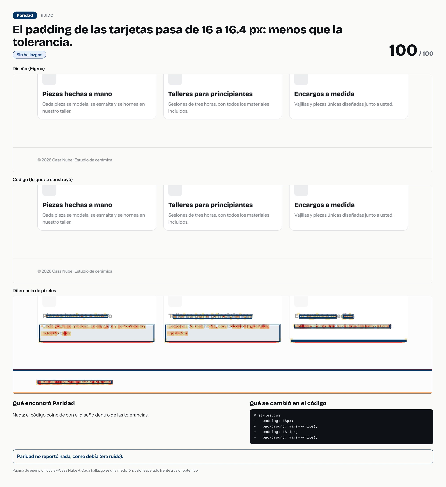

# El padding de las tarjetas pasa de 16 a 16.4 px: menos que la tolerancia.



- **Tipo de error:** ruido
- **Puntaje de paridad:** 100 / 100
- **Hallazgos:** 0 críticas · 0 altas · 0 medias · 0 bajas
- **Resultado de la evaluación:** ✅ acertó

## Lo que se cambió en el código

```diff
# styles.css
-   padding: 16px;
-   background: var(--white);
+   padding: 16.4px;
+   background: var(--white);
```

## Lo que Paridad encontró

Nada.

> Pasos para un caso de portafolio: la imagen es la historia visual; el `diff` es la causa; los hallazgos son la evidencia. Sin nombres de empresas ni de clientes.
