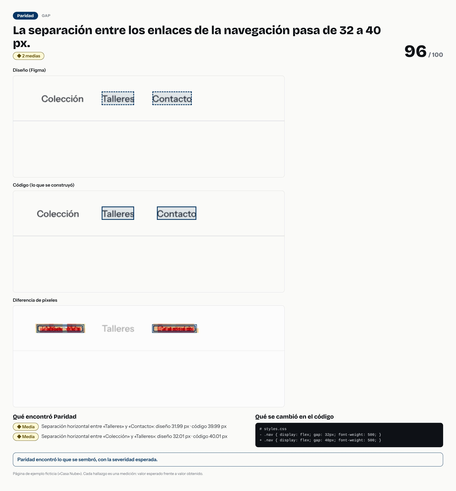

# La separación entre los enlaces de la navegación pasa de 32 a 40 px.



- **Tipo de error:** gap
- **Puntaje de paridad:** 96 / 100
- **Hallazgos:** 0 críticas · 0 altas · 2 medias · 0 bajas
- **Resultado de la evaluación:** ✅ acertó

## Lo que se cambió en el código

```diff
# styles.css
- .nav { display: flex; gap: 32px; font-weight: 500; }
+ .nav { display: flex; gap: 40px; font-weight: 500; }
```

## Lo que Paridad encontró

- **Media** · Separación horizontal entre «Talleres» y «Contacto»: diseño 31.99 px · código 39.99 px
  - separación horizontal: diseño `31.99` · código `39.99`
- **Media** · Separación horizontal entre «Colección» y «Talleres»: diseño 32.01 px · código 40.01 px
  - separación horizontal: diseño `32.01` · código `40.01`

> Pasos para un caso de portafolio: la imagen es la historia visual; el `diff` es la causa; los hallazgos son la evidencia. Sin nombres de empresas ni de clientes.
