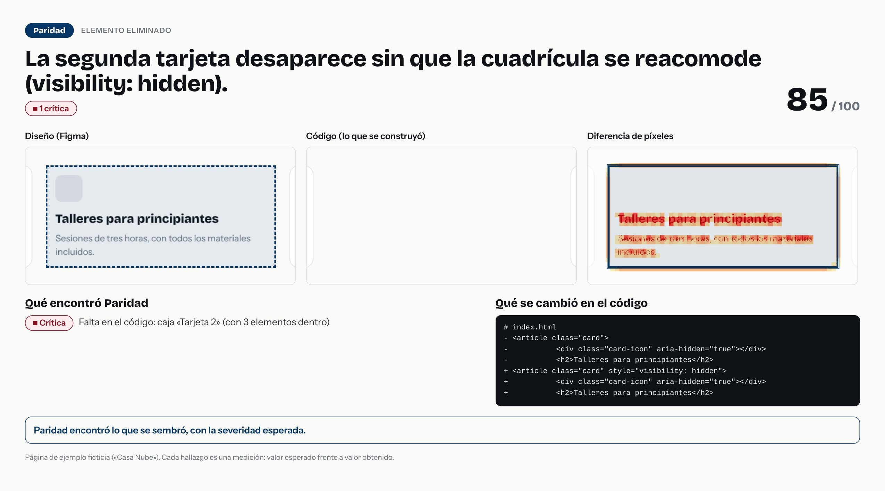

# La segunda tarjeta desaparece sin que la cuadrícula se reacomode (visibility: hidden).



- **Tipo de error:** elemento-eliminado
- **Puntaje de paridad:** 85 / 100
- **Hallazgos:** 1 críticas · 0 altas · 0 medias · 0 bajas
- **Resultado de la evaluación:** ✅ acertó

## Lo que se cambió en el código

```diff
# index.html
- <article class="card">
-           <div class="card-icon" aria-hidden="true"></div>
-           <h2>Talleres para principiantes</h2>
+ <article class="card" style="visibility: hidden">
+           <div class="card-icon" aria-hidden="true"></div>
+           <h2>Talleres para principiantes</h2>
```

## Lo que Paridad encontró

- **Crítica** · Falta en el código: caja «Tarjeta 2» (con 3 elementos dentro)
  - presencia: diseño `"presente"` · código `"ausente"`

> Pasos para un caso de portafolio: la imagen es la historia visual; el `diff` es la causa; los hallazgos son la evidencia. Sin nombres de empresas ni de clientes.
