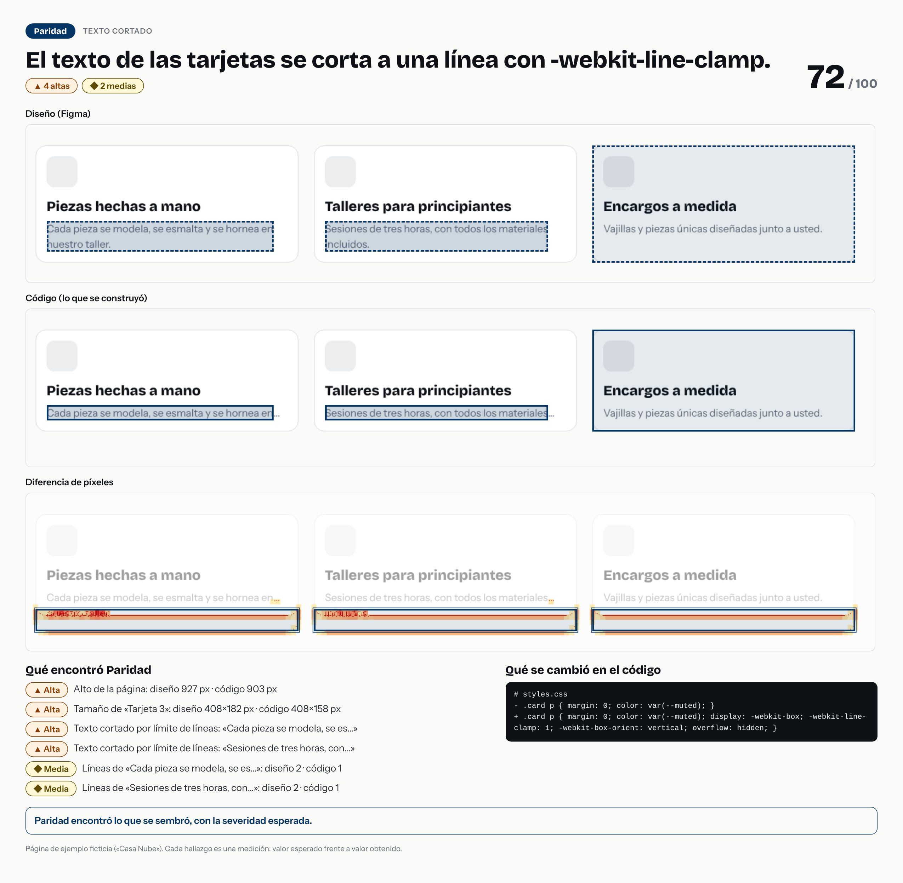

# El texto de las tarjetas se corta a una línea con -webkit-line-clamp.



- **Tipo de error:** texto-cortado
- **Puntaje de paridad:** 72 / 100
- **Hallazgos:** 0 críticas · 4 altas · 2 medias · 0 bajas
- **Resultado de la evaluación:** ✅ acertó

## Lo que se cambió en el código

```diff
# styles.css
- .card p { margin: 0; color: var(--muted); }
+ .card p { margin: 0; color: var(--muted); display: -webkit-box; -webkit-line-clamp: 1; -webkit-box-orient: vertical; overflow: hidden; }
```

## Lo que Paridad encontró

- **Alta** · Alto de la página: diseño 927 px · código 903 px
  - alto de la página: diseño `927` · código `903`
- **Alta** · Tamaño de «Tarjeta 3»: diseño 408×182 px · código 408×158 px
  - tamaño: diseño `{"width":408,"height":182}` · código `{"width":408,"height":158}`
- **Alta** · Texto cortado por límite de líneas: «Cada pieza se modela, se es…»
  - texto cortado: diseño `"completo"` · código `"line-clamp"`
- **Alta** · Texto cortado por límite de líneas: «Sesiones de tres horas, con…»
  - texto cortado: diseño `"completo"` · código `"line-clamp"`
- **Media** · Líneas de «Cada pieza se modela, se es…»: diseño 2 · código 1
  - líneas de texto: diseño `2` · código `1`
- **Media** · Líneas de «Sesiones de tres horas, con…»: diseño 2 · código 1
  - líneas de texto: diseño `2` · código `1`

> Pasos para un caso de portafolio: la imagen es la historia visual; el `diff` es la causa; los hallazgos son la evidencia. Sin nombres de empresas ni de clientes.
